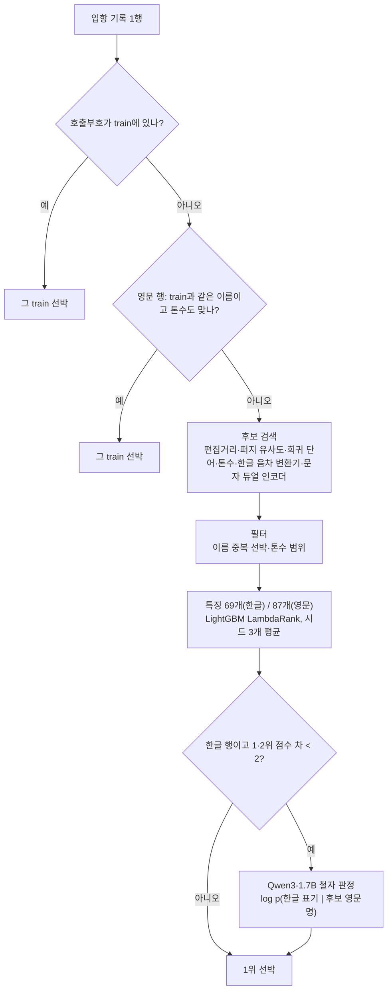

# 항만 입항 기록 ↔ 선박 카탈로그 매칭

DACON **「항만 문제해결을 위한 AI 기술 공모전」**(2026.10.12 ~ 11.02) 참가 코드입니다. 항만 입항 기록 한 줄이 카탈로그의 어느 선박인지 맞히는 문제입니다. 기록마다 선박명(한글 또는 영문), 호출부호, 톤수, 국적, 선종이 있고, 카탈로그에는 선박 78,595척이 있습니다.

최종 제출본 **v36js**의 구성은 이렇습니다.
- 규칙 단계
- 후보 검색
- LightGBM 순위 모델
- 문자 단위 듀얼 인코더
- 한글 근접 동점을 다시 판정하는 소형 LLM(Qwen3-1.7B) 철자 판정기

> English summary: code for a DACON entity-matching competition (Korean port-call records → a 78,595-vessel catalog). The pipeline has four stages: rules, candidate retrieval, then a LightGBM LambdaRank re-ranker with character-level dual-encoder features. A small LLM (Qwen3-1.7B) finally re-scores Hangul near-ties by spelling likelihood. Public LB 0.98196.

## 결과

| 항목 | 값 |
|---|---|
| Public 리더보드 점수 | **0.9819609983** |
| Public 오답 수 (점수에서 역산) | 한글 1,064행 중 14행, 영문 67,792행 중 1,995행 |
| 최종(Private) 결과 | 2026-11-06 발표 예정 |

평가 점수는 `0.7 × 한글 행 정확도 + 0.3 × 비한글 행 정확도`입니다. 한글 행이 적기 때문에 한글 1행이 영문 약 149행과 같은 무게입니다. 리더보드 점수는 소수 10자리까지 공개되므로 `tools/decode_lb.py`로 한글·영문 오답 수를 정확히 역산할 수 있습니다. 실험은 모두 이 오답 수를 기준으로 비교했습니다.

### 한글 오답이 줄어든 과정 (Public)

| 버전 | 바꾼 것 | 한글 오답 |
|---|---|---:|
| v28g | 영문 듀얼 인코더를 하드 네거티브 마이닝으로 재학습 (영문 오답 2,147 → 1,995) | 36 |
| v29g | 한글 합성 표기 생성기 kogen6 (병음 처리, 외래어 엔진, 한국어 음운 변동) | 32 |
| v29h → v29i → v29j | 듀얼 인코더 학습량 확대 (40 → 120 → 200 epochs, 합성 이름 7만 개) | 28 → 22 → 20 |
| v29v | 듀얼 인코더 폭 2배 (임베딩 96, 합성곱 폭 320) | 18 |
| v36a | **Qwen3-1.7B 철자 판정기** 추가 | **14** |
| v36js (최종) | 판정 구간을 점수 차 2 미만으로 좁히고 부분집합 가드 추가 | 14 |

## 방법



**1. 데이터에서 찾은 규칙**
- 호출부호는 선박별 고유 키입니다. train의 호출부호 5,851개와 선박 5,851척이 1:1로 대응합니다.
- 정답 선박은 카탈로그에서 이름이 유일한 선박뿐이었습니다.
- 영문 이름의 오타는 정해진 규칙(6글자 이상 단어에서 삭제·중복·인접 교환)으로 생성됩니다.
- 톤수는 정확히 일치하거나 ±3~5% 범위에서 교란됩니다.

이 사실들을 후보 필터와 특징(오타 경로 우도, 톤수 우도)으로 옮겼습니다.

**2. 후보 검색과 순위 모델**
- 후보 검색: 이름 편집거리, 퍼지 유사도, 희귀 단어 공유, 톤수 일치, 그리고 한글 행은 EM으로 학습한 자모 단위 음차 변환기를 씁니다.
- 순위 모델: 후보마다 이름·톤수·국적·선종 특징을 만들고 LightGBM LambdaRank로 순위를 매깁니다.
- 학습 데이터: train 행에 서버 데이터와 비슷한 잡음(오타, 톤수 교란, 약어화)을 넣은 복사본으로 학습했습니다.
- 대회 규칙상 각 테스트 행은 다른 테스트 행을 보지 않고 독립적으로 예측합니다.

**3. 문자 단위 듀얼 인코더**
- 구조: 한글 표기와 카탈로그 영문명을 같은 공간에 넣는 작은 문자 CNN 인코더입니다. 코사인 유사도를 후보 검색과 순위 모델 특징으로 씁니다.
- 학습 데이터 문제: train에 한글 선박이 382척뿐이라, 합성 한글 표기 생성기(`kogen6`)로 학습 쌍을 만들었습니다.
- 생성기 규칙:
  - 외래어 표기법 기반 영어 읽기
  - 중국 병음 읽기
  - 알파벳 낭독(KMTC → 케이엠티씨)
  - `제N호` 형식
  - 한국어 음운 변동
- 학습 방식: 5-fold로 학습하고, 순위 모델에는 각 행이 학습에 쓰이지 않은 폴드의 인코더 특징을 넣었습니다.

**4. LLM 철자 판정 (Qwen3-1.7B)**
- 대상: 순위 모델의 1·2위 점수 차가 2 미만인 한글 행입니다.
- 판정: 각 후보 영문명이 주어졌을 때 그 행의 한글 표기가 나올 로그 확률 ℓ을 10-shot 프롬프트로 계산합니다. ℓ(2위) − ℓ(1위) > 3이면 2위를 답합니다.
- 부분집합 가드: 2위 이름의 단어가 1위 이름 단어의 진부분집합이면 바꾸지 않습니다. 항만 기록에서 단어가 빠지면 판정기가 항상 짧은 이름을 선호하기 때문입니다.
- 출처: 공개 범용 사전학습 가중치이며, 대회 규칙상 허용됩니다.

## 실험에서 배운 것

- **합성 검증셋은 판정기 효과를 과소평가했습니다.** 카탈로그로 만든 합성 한글 검증셋에서는 판정기가 오히려 손해였는데, 실제 리더보드에서는 한글 오답을 18개에서 14개로 줄였습니다.
- **판정 구간을 넓히면 실제 데이터에서 무너집니다.** 합성 검증셋에서 깨끗했던 규칙이 있었습니다. 순위 점수 차 3~4 구간에서 판정기가 15 nats 넘게 확신할 때만 바꾸는 규칙입니다. 그런데 이 규칙도 실제로는 판정 모델 세 종류 모두에서 한글 오답을 2개씩 늘렸습니다. 이 구간에는 철자는 다른 배와 더 비슷하지만 순위 모델이 다른 정보로 맞힌 실제 행이 있습니다.
- **같은 레시피라도 학습할 때마다 결과가 크게 다릅니다.** 같은 설정으로 다시 학습한 듀얼 인코더(v29q2)는 Public 한글 오답이 6개 많았습니다. 여러 실현값을 섞는 중재 방식도 오답을 2개 늘렸습니다.
- **학습량은 효과가 있었고, 폭은 적당한 선이 있었습니다.** 학습량을 늘리면 오답이 꾸준히 줄었습니다(28 → 22 → 20). 인코더 폭은 320에서 가장 좋았고 480에서는 다시 나빠졌습니다.
- **영문 쪽 로컬 지표는 믿을 수 없었습니다.** 로컬 지표(OOF, 비교셋)는 좋아졌지만 리더보드에서는 나빠진 경우가 많았습니다. 그래서 영문 경로는 v28g로 고정했습니다.

## 저장소 구조

```
submission/              최종 제출 패키지 v36js의 코드 (서버의 script.py 실행 규격)
  script.py              추론 진입점: 규칙 → 후보 → 순위 모델 → LLM 판정
  requirements.txt
  model/ko/vm_ko/        한글 경로: 정규화·음차 변환기·듀얼 인코더·후보/특징 계산
  model/en/vm_en/        영문 경로: 같은 구조 + 약어 정렬
  model/*/manifest.json  순위 모델 특징 목록과 하이퍼파라미터
  model/llm/judge.py     LLM 철자 판정기
training/
  common/                후보 쌍 생성·잡음 증강·합성 국내선 쌍·LightGBM 학습 (train14*, aug14, domtrain, fit20 …)
  hangul/                한글 듀얼 인코더 학습 체인 (build_ko5_gpu.sh, dualenc_v2dom7_gpu.py, kogen6, loanword …)
  latin/                 영문 듀얼 인코더와 순위 모델 학습 체인 (build_en2.sh, de_en2.py, train14_ende.py, fit_en.py …)
  capcpu/                CPU 코어 사용량 제한 (학습 중 다른 작업과 병행용)
llm_judge/               LLM 판정기 사전 연구 (평가셋 구성, 점수 계산, τ×κ 격자 분석)
tools/                   리더보드 점수 역산, 스트리밍 zip 패키징, zip 검증, DACON 제출 API 래퍼
```

학습 체인의 실행 순서와 정확한 레시피는 [training/README.md](training/README.md)에 있습니다.

## 실행 방법

### 추론

1. Python 3.11 환경에서 `pip install -r submission/requirements.txt`를 실행합니다. LLM 판정을 쓰려면 `torch`, `transformers`도 설치합니다.
2. DACON 대회 페이지에서 `train.csv`, `vessel_catalog.csv`, `test.csv`를 받습니다.
   - `train.csv`는 `submission/model/train.csv`에 둡니다.
   - `test.csv`와 `vessel_catalog.csv`는 `data/` 폴더에 둡니다.
3. 학습된 가중치는 저장소에 없습니다. [training/README.md](training/README.md)의 체인으로 다음 파일을 만듭니다.
   - `submission/model/ko/de/*.npz`, `submission/model/ko/lgb_seed*.txt`
   - `submission/model/en/` 아래의 같은 파일들
4. Qwen3-1.7B 가중치를 `submission/model/llm/Qwen3-1.7B/`에 받습니다. 예: `huggingface-cli download Qwen/Qwen3-1.7B --local-dir submission/model/llm/Qwen3-1.7B`
5. 다음 명령을 실행합니다.

   ```bash
   python submission/script.py --data-dir data --output output/submission.csv
   ```

torch나 LLM 가중치가 없으면 판정 단계만 건너뛰고 순위 모델의 답을 그대로 냅니다.

### 학습

[training/README.md](training/README.md)를 보세요. 한글 듀얼 인코더(폴드 5개 + 전체 데이터 1개, 모델 6개)는 GPU(RTX 3060)에서 학습했고, 200 epochs 레시피는 몇 시간 걸립니다. 후보 쌍 생성과 LightGBM 학습은 CPU에서 돌렸습니다.

## 공개 범위와 데이터

- **포함하지 않은 것**
  - 대회 데이터(`train.csv`, `test.csv`, `vessel_catalog.csv`)
  - 그 데이터에서 만든 파생 파일: 후보 쌍, 카탈로그 임베딩, 합성 검증셋, 카탈로그 단어 목록 등
  - 학습된 가중치
  - 대회 규칙이 대회 데이터의 무단 재배포를 금지하기 때문입니다.
- **10-shot 예시:** LLM 판정 프롬프트의 예시 10쌍은 train.csv의 실제 행입니다. 그래서 저장소에는 행 ID(`SHOT_SAMPLE_IDS`)만 두었고, 실행할 때 train.csv와 카탈로그에서 같은 순서로 복원합니다. 제출본과 같은 프롬프트가 만들어지는 것을 확인했습니다.
- **주석 속 예시:** 코드 주석의 선박명 예시는 가상의 이름으로 바꿨습니다. 그 밖의 동작은 제출본 v36js와 같습니다.
- **경로:** 개인 환경의 절대경로는 환경 변수(`SEOKCHEON_WS`, `PY`, `TPY`)로 바꿨습니다.

## 라이선스

코드는 [MIT License](LICENSE)를 따릅니다. Qwen3 가중치는 Qwen의 Apache-2.0 라이선스를 따르고, 대회 데이터는 DACON 대회 약관을 따릅니다.
